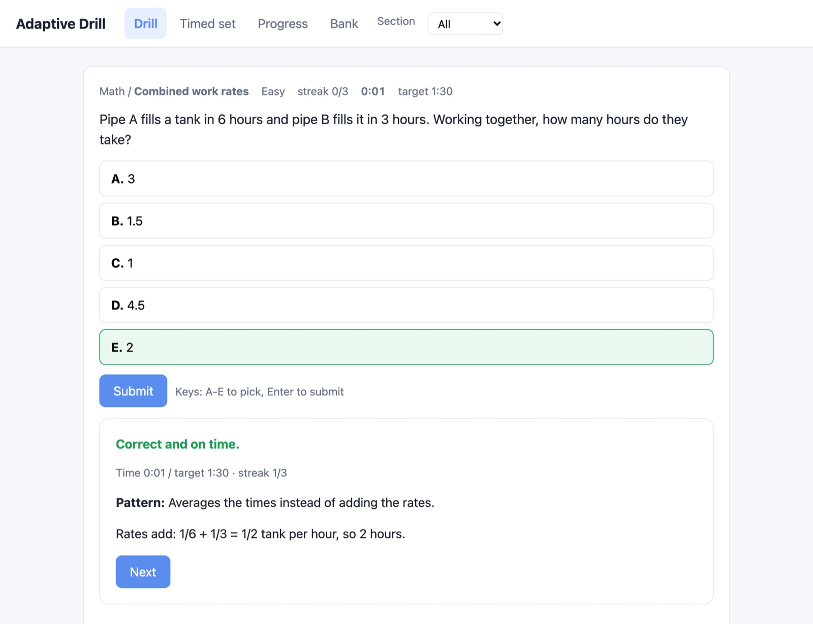
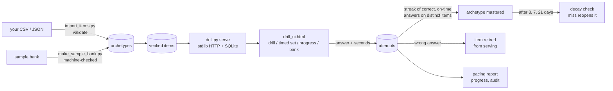

# Adaptive Drill Engine

A local practice app for any multiple-choice subject: it groups questions by the mistake they test, drills each mistake pattern until it is mastered under time, and grades timed sets on pacing as well as score.

**Plain-words write-up:** [A study app built around mistakes](https://ryanwisth.github.io/practice-engine.html)



## Why it exists

Topic-level practice treats every miss in "percents" the same, but most misses come from one specific error: adding two percent changes instead of multiplying them, reading "P only if Q" backwards, averaging times instead of adding rates. This engine stores each of those errors as an **archetype** and drills it directly. An archetype counts as mastered only after several consecutive answers that are both correct and inside the target time, on different questions, and it comes back for decay checks days and weeks later. It is a learning tool: bring your own questions (CSV or JSON), or start from the 21 original sample items.

## How it works



## Features

- **Archetype drilling.** Each item belongs to an archetype (one mistake pattern). The drill shows the archetype, a live timer against its target time, and after each answer the explanation plus the pattern it trains against.
- **Mastery rule.** 3 consecutive answers that are correct and on time, across 3 distinct items (both numbers capped at the archetype's live items). A slow right answer does not extend the streak.
- **Decay checks.** Mastered archetypes come back after 3, 7 and 21 days. A miss reopens the archetype.
- **Verified-item gating.** Only items with `verified = 1` are served. Imports can be staged unverified and released with `drill.py verify`.
- **No recall effects.** Choices are shuffled on every serve, a seen item cools down for 48 hours, and an item answered wrong is never served again (its explanation has been seen).
- **Interleaving.** After a correct answer the archetype rotates behind the others; after a miss it stays in front.
- **Timed sets.** A mixed set, round-robin across archetypes, on one clock. Exam-style controls: previous/next, flag for review, a review grid, answer changes counted, auto-submit at time-out.
- **Pacing report.** Checkpoints at the 1/3 and 2/3 marks against even pace, items over 1.5x their target, "sinkholes" (far over cap and wrong), and time left for the last three items.
- **Progress and bank views.** Windowed analytics (24 hours, 7 days, 30 days), mastered archetypes, misses, per-archetype streaks and accuracy, and a bank audit (bad keys, duplicate choices or stems, near-clones, missing explanations, thin archetypes).
- **Importer.** `import_items.py` loads CSV or JSON with validation and `--dry-run`.

## Design decisions

- **Mistake patterns, not topics.** The unit of practice is the error, so practice targets the cause instead of the chapter.
- **Speed is part of mastery.** Knowing how to do something slowly is not the same as being able to do it under a clock, so the streak only counts on-time answers.
- **Distinct items.** A streak on one repeated question proves memory, so mastery has to span different questions.
- **Burn on a miss.** Once the explanation of an item has been shown, a later correct answer may be recall. The item leaves every serving path; the audit tells you which archetypes need fresh items. This is derived from the attempts table, so it needs no extra state.
- **Pacing as a separate grade.** A timed set can score well and still be paced badly (one item eating three minutes). The report separates time that bought a right answer ("spent") from time sunk into a wrong one ("lost").
- **Standard library only.** One Python file (`sqlite3` + `http.server`) and one HTML file, no build step and no dependencies, so it runs anywhere Python 3.9+ runs. Time windows use `julianday()` because the ISO timestamps would compare wrongly as plain strings.

## Quick start

Requirements: Python 3.9 or newer. No packages to install.

```bash
python3 make_sample_bank.py          # builds drill.db with 21 sample items in 7 archetypes
python3 drill.py serve               # open http://127.0.0.1:8780
```

Other commands:

```bash
python3 drill.py status              # mastery table
python3 drill.py progress --hours 168
python3 drill.py audit               # exit code 1 if any item has a problem
python3 drill.py pace --list         # finished timed sets; `pace ID` for one report
python3 drill.py show --archetype 3
python3 drill.py verify --archetype 3
```

Set `DRILL_DB=/path/to/file.db` to keep the database elsewhere.

## Loading your own questions

```bash
python3 import_items.py sample/example_import.csv --dry-run   # validate only
python3 import_items.py sample/example_import.csv             # import, verified
python3 import_items.py my.json --unverified                  # import, hold back until `drill.py verify`
```

| Field | Required | Notes |
|---|---|---|
| `section` | yes | Any label (Math, Logic, Spanish). Sections come from your data. |
| `archetype` | yes | The mistake pattern (alias `topic`). Items with the same section and archetype share one streak. |
| `stem` | yes | Question text. |
| `choices` | yes | 2 to 8 options. JSON list, or one CSV cell separated by ` \| `. |
| `key` | yes | Letter (`A` = first choice), 1-based number, or the exact text of the right choice. |
| `difficulty` | no | Free text. |
| `explanation` | no | Shown after answering. The audit warns when it is missing. |
| `pattern` | no | One-line description of the trap, shown after answering. |
| `target_seconds` | no | Target time for the archetype (default 90). |

A JSON file is a list of objects with the same keys (or `{"items": [...]}`). The importer rejects the whole file if any row fails validation, and re-running it skips items already present.

## Project structure

```
drill.py                  engine, mastery logic, pacing report, audit, JSON API, CLI
drill_ui.html             single-page browser UI (drill, timed set, progress, bank)
import_items.py           CSV / JSON importer with validation and --dry-run
make_sample_bank.py       builds the demo database; verifies only machine-checked items
sample/sample_questions.py  21 original items, each with a machine check
sample/example_import.csv   importer format example
```

## Status

Working local app, tested by building the sample bank, running the server on localhost and exercising the drill, answer, timed-set, progress, pacing and audit endpoints. Single user, no authentication: bind it to localhost only. There are no automated tests in the repository yet. The UI has been checked for syntax, not across browsers. Items are text only (no images or formulas).

This public version is a generic, reduced build of a larger personal practice tool. Features tied to one specific exam and its source material were removed, along with question generation by a local language model.

Possible next steps: an automated test suite, item editing in the UI, and spaced review for items that were answered correctly but slowly.

## How this was built

Ryan Wisth built this by directing AI coding agents (Claude Code), setting the goals, the learning rules (mistake-pattern archetypes, the mastery and burn rules, pacing grades) and the acceptance checks, and verifying the results by using the tool for their own study. The code was written by the agents under that direction.

## License

MIT. See [LICENSE](LICENSE).
